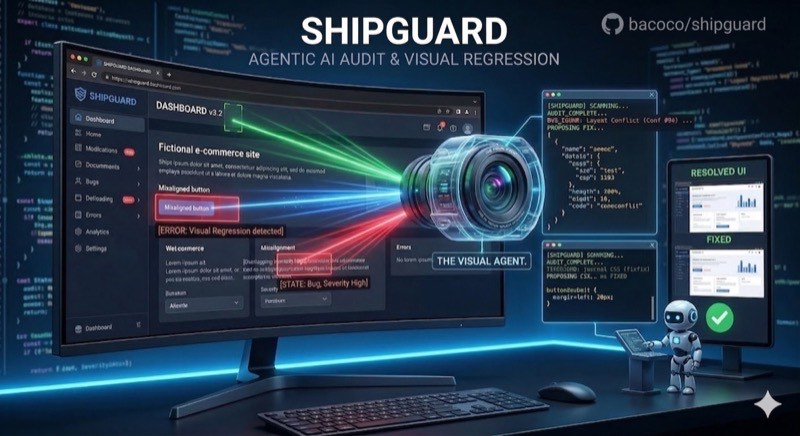

# ShipGuard plugin

ShipGuard is a Claude Code and Codex plugin for scope protection, code and logic audits,
process checks, visual testing, browser-flow recording, and review dashboards.

The [root README](../../README.md) is the complete, canonical guide for features, installation,
configuration, compatibility, and usage.

## Plugin package references

- [`skills/`](skills/) contains the canonical skill instructions.
- [`cli/shipguard.mjs`](cli/shipguard.mjs) is the standalone deterministic CLI.
- [`docs/codex-migration.md`](docs/codex-migration.md) covers migration to the Codex plugin.
- [`docs/dialogue-hooks.md`](docs/dialogue-hooks.md) documents the optional dialogue hooks.
- [`docs/communication-memory.md`](docs/communication-memory.md) documents private communication memory.
- [`docs/sandbox.md`](docs/sandbox.md) describes sandbox requirements and limitations.

ShipGuard is licensed under the [MIT License](LICENSE).
